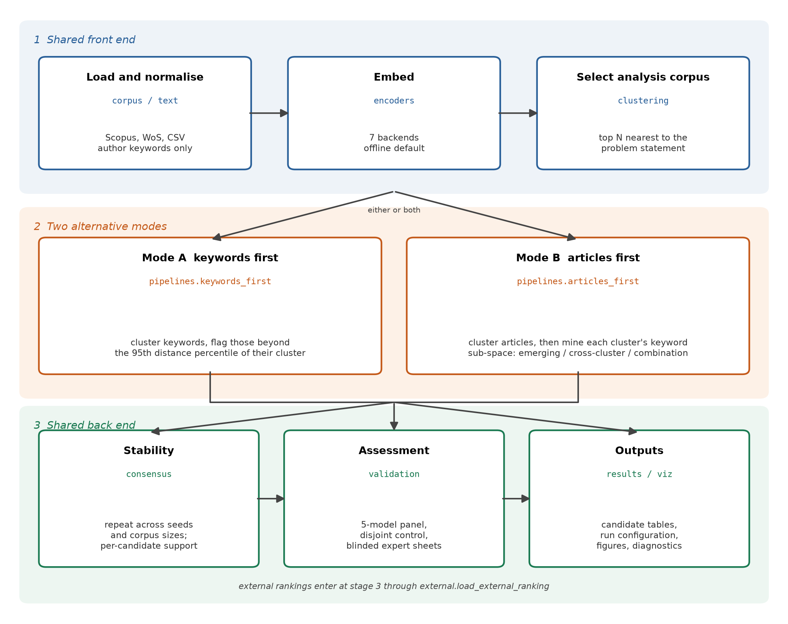
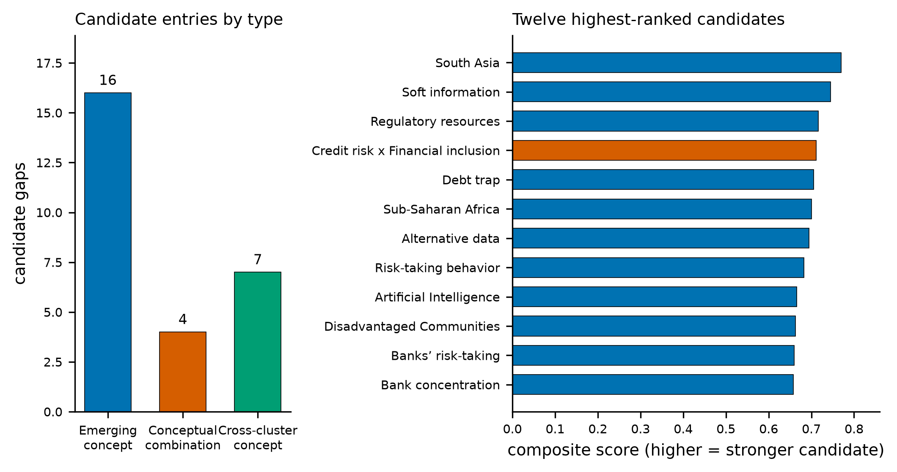
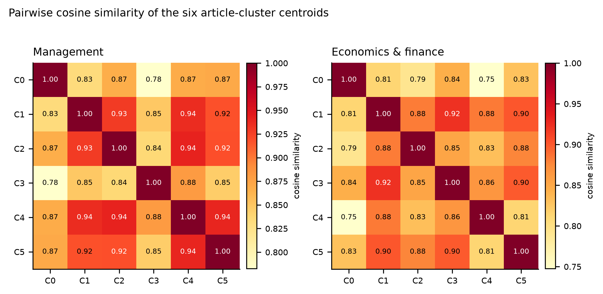
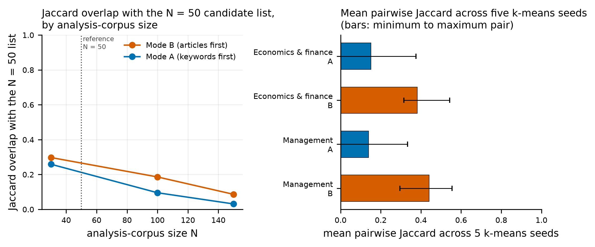

# EmbedResearchGaps: embedding-based shortlisting and stability assessment of candidate research gaps in author-keyword space

anonymized for review

## Abstract

Literature screening is increasingly automated, but experts must still identify what screened corpora leave unexplored. EmbedResearchGaps implements two published methods for finding candidate gaps from author keywords: cluster-periphery detection, and article-cluster mining for emerging concepts, cross-cluster concepts and unrealized combinations. It adds seven embedding backends, five-model annotation, blinded expert sheets and a consensus layer, with 387 tests at 93% coverage. On three Scopus corpora candidate lists moved with every analysis choice: Jaccard overlap was 0.14-0.44 across seeds and 0.00-0.23 across the three backends evaluated, and no partition exceeded a silhouette of 0.07. Against a disjoint control the ranking showed no reliable novelty enrichment (largest contrast +13.0 pp, 95% CI -5.9 to 32.0) and no advantage over a random draw of equally rare keywords.

**Keywords:** research gaps; semantic embeddings; keyword clustering; literature review; bibliometrics; reproducibility

## Metadata

| Nr | Code metadata description | Metadata |
|----|---------------------------|----------|
| C1 | Current code version | v1.1.0 |
| C2 | Permanent link to code/repository used for this code version | anonymized for review |
| C3 | Legal code license | MIT License |
| C4 | Code versioning system used | git |
| C5 | Software code languages, tools and services used | Python (>= 3.10); numpy, pandas, scipy, scikit-learn, matplotlib, networkx, kneed, requests, typer |
| C6 | Compilation requirements, operating environments and dependencies | Pure Python 3.10 or newer, no compilation: pip install embedresearchgaps |
| C7 | If available, link to developer documentation/manual | anonymized for review |
| C8 | Support email for questions | anonymized for review |

## 1. Motivation and significance

A reviewer who has completed screening faces a question no tool answers: which of the roughly 150 author keywords in an accepted corpus point to underexplored directions? Screening itself is automated repeatedly, through active-learning frameworks [1] and embedding-based ranking as in EmbedSLR [2,3], and reporting standards specify how a review is documented [4]; but moving from a screened corpus to a shortlist still rests on unaided reading [5]. Gap categories are formalized [6], yet identification remains non-mechanical, and gap-spotting has been criticized as an insufficient basis for research questions when not grounded in problematization [7].

Neighbouring traditions exist: literature-based discovery infers untested links between disjoint literatures, from Swanson's ABC paradigm to modern implementations [8,9]; link prediction on co-occurrence networks forecasts which term pairs will co-occur [10]; topic models and their embedding-based successors summarize a corpus into themes an analyst inspects [11]; and language models increasingly summarize and interpret literature [12]. These infer links, themes or summaries. The task here is narrower: rank the author keywords of an already screened corpus so an expert reads fewer of them. No ranking can identify what a field has not yet asked, which needs interpretation rather than classification against ground truth.

Two recent procedures generate such shortlists: one clusters author keywords and flags peripheral terms [13]; the other clusters articles, then searches each cluster's keyword subspace for emerging concepts, untested combinations of established terms, and concepts present elsewhere in the corpus but absent from that cluster [14]. Both were evaluated by a multi-model panel against a calibrated rubric and compared with two experts in a pilot [13,14]. That design rests on evidence that language models annotate some text tasks reliably [15-17] — evidence from political-text and crowd-work coding, which does not establish validity for gap assessment, and model annotators carry position, verbosity and self-preference biases [18]. Neither study released software or tested whether candidates persist when the clustering is rerun.

This paper turns that work into a reusable tool and asks three questions. Can the procedures be reproduced under configuration control? How far do candidate lists move with the k-means seed, the corpus size and the backend? And does the ranking enrich the shortlist for novelty beyond its own filters and beyond a random draw of equally rare keywords? The third is the hypothesis tested, with the filters and a rarity-matched selection as baselines. Packaging also allows the second procedure's positive result to be re-examined: it reported the panel's GAP rate rising from 38.1% for the full keyword population to 77.5% for the candidates, a comparison whose control contains the candidates (Section 3.5).

Author keywords suit shortlisting: author-assigned, short, and long used in bibliometric work that visualizes co-occurrence while leaving interpretation to analysts [19-22]. Emerging-topic research relies on citation and term bursts rather than semantic spaces [23], whereas sentence embeddings [24,25] make keyword neighborhoods computable and separate short texts better than bag-of-words models [26].

## 2. Software description

### 2.1 Software architecture

A shared front end loads a bibliographic export, normalizes author keywords, deduplicates records, embeds texts and selects the analysis corpus by proximity to the stated research problem. Two modes mine that corpus, and a shared back end measures stability, supports assessment and writes tables, figures and the run configuration (Fig. 1).

Thirteen top-level modules and a five-module validation subpackage divide the work: `config`, `corpus` and `text`, `encoders`, `clustering`, `gaps` (four detectors, three scoring formulae), `external` (rankings from other tools), `consensus`, `results`, `pipelines`, `viz` and a command-line interface. The 387 tests enforce cross-process determinism: with fixed data, embeddings and `RunConfig`, runs reproduce exactly, and `precomputed` preserves published vectors, so a deposited run regenerates without a hosted endpoint.



### 2.2 Software functionalities

**Two operating modes.** `keywords_first` (Mode A) clusters the unique author keywords and flags keyword *w* when its cosine distance from its own cluster centroid exceeds the 95th percentile of distances within that cluster, so clusters of different density are judged on their own scale. `articles_first` (Mode B) clusters the articles, labels each cluster from its frequent non-core keywords, builds a keyword sub-space per cluster and applies three detectors: *emerging concept*, document frequency at or below the ceiling *c* = max(1, round(N/50)); *conceptual combination*, a pair of established keywords with cosine similarity in [0.45, 0.80] and no article carrying both; *cross-cluster concept*, a keyword frequent elsewhere in the corpus but absent from the cluster under test. Each candidate carries a composite score, a weighted sum of min-max-normalized components (emerging concepts: 0.25 rarity, 0.15 centrality, 0.30 TF-IDF salience, 0.30 recency). Weights and thresholds reproduce the source procedures [13,14]; they were not tuned and no ablation is reported, so they are defaults, not optima. Normalization is within one run's candidate set, so scores order candidates within a run but not across runs, and the consensus layer pools membership rather than scores.

Shared filters remove terms peripheral for non-substantive reasons: the frequency ceiling, a token-count rule, a blocklist of 56 methodological phrases fixed before any analysis, and a core-domain filter dropping terms in more than half the records. The ceiling scales with N, so candidate sets from different corpus sizes are not directly comparable; `GapConfig` also accepts a fixed ceiling.

**Seven embedding backends.** `tfidf-svd` is offline and deterministic, `sbert` runs any sentence-transformers checkpoint locally, `openai`, `nomic`, `jina` and `cohere` call hosted endpoints, and `precomputed` accepts user-supplied vectors; Section 3.6 evaluates three, the other hosted backends being covered only by recorded-transport tests. All share one contract that validates the vector count and rejects non-finite values, and `precomputed` keys vectors by text rather than row position, so a stale mapping raises instead of misaligning silently. API keys come from environment variables and never enter a configuration object, a result file or a log. `load_csv` resolves canonical fields through an alias table covering the Scopus CSV export, the Scopus Search API and both Web of Science export flavors; Keywords Plus is excluded because the database, not the authors, generates it.

**Stability-aware consensus.** `consensus_gaps` repeats a mode across seeds and, optionally, corpus sizes, reporting per-candidate the fraction of runs producing it and, per run pair, the candidate-set overlap, separated by source of variation. A partition whose silhouette [27] falls below 0.10 raises `LOW_CLUSTER_SEPARATION`; that threshold, the k-selection acceptance threshold (0.25) and the periphery percentile are `RunConfig` parameters, so their effect on the list can be read directly.

**Candidate assessment.** The validation subpackage implements the source protocol verbatim: each keyword receives a label (GAP, EXPLORED, LOW IMPORTANCE, METHOD or NOISE) and a Novelty Score from 1 to 10. The prompt carries the keyword, the research problem and the rubric but not the corpus, so scores reflect general knowledge rather than novelty within the analyzed articles; Section 3.3 tests how far they track rarity instead. Seven annotator backends are registered, six hosted chat endpoints at temperature 0 and `CallableAnnotator` for local functions; since temperature 0 does not guarantee reproducibility across model revisions, raw judgments, model identifiers and access dates are deposited. The module computes label rates, agreement coefficients and candidate-control comparisons: `selected_and_control_keywords` builds a control disjoint from the candidates and `compare_keyword_sets` withholds parametric p-values when arms share a keyword. Blinded expert sheets are exported and read back for Spearman correlation. `load_external_ranking` reads a candidate list produced elsewhere into the same result object, so another tool's ranking can be scored against the same control (Section 3.4).

A minimal run, from export to expert sheet:

```python
from embedresearchgaps import RunConfig, EncoderConfig, articles_first, load_csv
from embedresearchgaps.consensus import consensus_gaps
from embedresearchgaps.validation import build_expert_sheet

corpus = load_csv("scopus.csv")
config = RunConfig(
    top_n_articles=50,
    problem_description="How does fintech credit affect financial inclusion?",
    article_encoder=EncoderConfig(name="sbert", model="all-mpnet-base-v2"),
)
result = articles_first(corpus, config)          # typed, scored candidates
consensus = consensus_gaps(corpus, "articles_first", config,
                           seeds=(42, 7, 123, 2024, 99))
consensus.gaps.query("support >= 0.5")           # the reproducible shortlist
result.save("results/finance")                   # tables, diagnostics, run config
build_expert_sheet(result, config.problem_description).to_excel("experts.xlsx")
```

Seven figures are produced headlessly, and every run returns the diagnostics a methods section needs: cluster sizes and quality indices [28,29], the k-selection trace [30], the TF-IDF match-type breakdown and per-cluster years.

## 3. Illustrative examples

Two Scopus corpora were retrieved: 493 records on dynamic capabilities and digital transformation, and 487 on fintech credit, financial inclusion and bank lending, each with a one-sentence problem statement (S1); a third of 290 records on gamification in marketing shares its topic, not its retrieval, with [14]. Queries, dates, identifiers, all tables and the regeneration scripts are deposited [31]. Selecting the N articles nearest the problem statement plays the role screening plays in a review; N = 50 by default.

**Table 1.** Runs in this section. Keywords: distinct author keywords in the analysis corpus. E/X/C/P: emerging concepts, cross-cluster concepts, conceptual combinations, peripheral keywords. Seed J and RBO: mean pairwise Jaccard and rank-biased overlap across five k-means seeds. Support: candidates reaching majority support, of the pooled total across twenty runs. The last column is the keyword-level GAP-rate difference against the disjoint control.

| Corpus | Mode | Keywords | k | Silhouette | Candidates (distinct) | E/X/C/P | Seed J | RBO | Support >= 0.5 | GAP rate vs control (pp, 95% CI) |
|---|---|---|---|---|---|---|---|---|---|---|
| Management | B | 146 | 6 | 0.033 | 27 (26) | 18/7/2/0 | 0.44 | 0.34 | 12/161 | -1.2 [-17, 15] |
| Management | A | 146 | 6 | 0.051 | 6 (6) | 0/0/0/6 | 0.14 | 0.10 | 2/50 | -8.0 [-37, 24] |
| Economics & finance | B | 168 | 6 | 0.055 | 27 (25) | 16/7/4/0 | 0.38 | 0.27 | 11/166 | +13.0 [-6, 30] |
| Economics & finance | A | 168 | 6 | 0.051 | 4 (4) | 0/0/0/4 | 0.15 | 0.14 | 1/37 | -9.3 [-35, 28] |
| Gamification | B | 172 | 6 | 0.017 | 28 (26) | 18/7/3/0 | 0.32 | 0.38 | n/a | -9.1 [-24, 6] |
| Gamification | A | 172 | 8 | 0.069 | 6 (6) | 0/0/0/6 | 0.19 | 0.03 | n/a | -3.5 [-33, 28] |

### 3.1 Candidate outputs of the two modes

The k-selection routine evaluates silhouette across the configured range and falls back to the elbow criterion [30] below the 0.25 acceptance threshold; k = 6 was selected throughout. Mode B returned 27 entries covering 26 distinct keywords in management and 27 covering 25 in economics and finance, of which 24 enter the panel study because the four conceptual combinations are scored through their constituent terms; Mode A returned 6 and 4 peripheral keywords (Table 1, Figs. 2 and 3). Emerging concepts dominate the type mix, partly by definition: 54-62% of Mode B candidates and every Mode A candidate occur in exactly one record, and all candidates are multi-token. Every partition falls below the 0.10 silhouette threshold and raises `LOW_CLUSTER_SEPARATION`; centroid similarities range from 0.75 to 0.94 (Fig. 4). Distance concentration in high-dimensional embeddings depresses silhouette even where structure exists, so these runs test the pipeline under weak separation. Candidates mix research directions, scope terms and, in one record, two personal names mis-entered as author keywords, which the panel labeled NOISE with a Novelty Score of 1.

![**Fig. 2.** Author-keyword space of the management corpus: t-SNE [32] projection of the keyword embeddings, colored by dominant article cluster, marker area proportional to the square root of document frequency, Mode B candidates outlined.](figures/fig2_keyword_space.png)





### 3.2 Candidate-list stability

Across five k-means seeds, mean pairwise Jaccard overlap was 0.44 for Mode B and 0.14 for Mode A in management, and 0.38 and 0.15 in economics and finance (Fig. 5); the least stable Mode A pair shared no candidates. Resizing gave 0.09-0.31 and 0.00-0.38, partly because k was re-selected in every run and ranged from 4 to 9. Pooling five seeds and four sizes, mean overlap was 0.23 and 0.19, decomposing into 0.45 and 0.39 between same-size pairs and 0.18 and 0.14 across sizes (supplementary S6b); the 0.14 above is measured across seeds at N = 50 and is therefore not the 0.288 of that table, which pools all same-size pairs.

Because the output is a reading order, set overlap is not sufficient. On the offline backend, which needs no credentials, rank-biased overlap (p = 0.9) across five seeds is 0.27-0.38 for Mode B and 0.03-0.14 for Mode A, and top-10 overlap 0.41-0.49 and 0.06-0.16 (S6c): roughly half of a Mode B top-10 recurs under a different seed, while a Mode A ranking does not recur at all.

Consensus support makes this explicit (Table 1): of 161 distinct candidates across twenty management Mode B runs, 12 reach majority support and 2 are unanimous. Support is not validity: the two names left by the metadata error reach 0.85 and 0.75.



### 3.3 Multi-model annotation results

Five providers (GPT-4o, Claude Sonnet 4.6, DeepSeek V4 Pro, Grok 4.5, Gemini 2.5 Flash; versions and access dates in supplementary S8) assessed every candidate and every author keyword of each analysis corpus at temperature 0 against the same rubric. The unit of analysis is the keyword: the five judgments of a keyword are aggregated before arms are compared, and supplementary S14 repeats everything at the judgment level. The control is the keyword population minus the candidates. Ordinal Krippendorff's alpha [33] on the Novelty Score is 0.53-0.67 (95% bootstrap CI 0.45-0.74); Fleiss' kappa [34] on the labels, which the source studies report, is 0.45-0.70. Conceptual combinations are scored through their constituent terms, since the panel rates keywords rather than pairs.

Effect directions were inconsistent across the six comparisons (Fig. 6, left; Table 1). The largest is in economics and finance, where 24 Mode B candidates scored 4.03 against 3.58 for 144 control keywords: 0.46 points on the Novelty Score (95% CI -0.33 to 1.24) and 13.0 pp in GAP rate (95% CI -5.9 to 32.0, permutation p = 0.14). The other five differences are negative, from -1.2 to -9.3 pp; no interval excludes zero, and Holm adjustment [35] leaves the smallest adjusted p at 0.87 for the GAP rate and 1.00 for the Novelty Score. The design is not powerful: with 24-27 candidates per arm the minimal detectable difference at 80% power is 22-26 pp for Mode B and 49-54 pp for Mode A. Equivalence testing against a 10 pp margin, declared in advance because a 10 pp shift moves two to three items on a 25-item shortlist, also fails to reject (smallest TOST p = 0.15). Because keywords are nested within article clusters, the intervals were recomputed with a cluster bootstrap; they widen slightly and change no conclusion (economics and finance Mode B: 95% CI -2 to 35). The data neither demonstrate enrichment nor establish its absence: effects below roughly 20 pp cannot be resolved here.

Two checks bear on what the panel measures. The Novelty Score correlates only weakly with document frequency (Spearman rho = -0.05, -0.03, -0.23), so judgments are not a restatement of rarity; but they cannot certify a gap in the analyzed corpus, because the prompt omits it. The prefilters also remove the methodological, core-domain and single-token terms that the rubric labels METHOD, NOISE or LOW IMPORTANCE, so part of any filter-stage difference reflects agreement between filters and rubric rather than independent evidence. Decomposing by filter stage locates what little separation exists (Fig. 6, right): the filter contrast is positive in both corpora, 7.9 pp (95% CI -5.2 to 21.0) and 10.5 pp (-2.5 to 23.6), while the ranking contrast changes sign (-6.3 and +7.2 pp).


### 3.4 Comparison with simpler shortlists

Because the panel annotated every keyword, any shortlist of the same size can be scored on the same judgments. Three alternatives were compared: a random draw of k keywords, a draw restricted to the rare multi-token stratum the filters admit, and the k most frequent keywords. Mode B candidates reached GAP rates of 46.2%, 65.0% and 35.4% across the three corpora, against 47.2%, 53.7% and 43.1% for unrestricted random selection and 49.2%, 59.9% and 48.1% for the rarity-matched draw (95% intervals 36-62, 46-74, 37-59 pp). The ranking sits at the 31st, 75th and 1st percentile of the rarity-matched distribution, below its mean in five of six corpus-mode comparisons. The most frequent keywords do clearly worse (42.3%, 49.2%, 26.2%), so the frequency ceiling carries signal, but the ranking cannot be shown to improve on a random choice among the rare keywords it admits. A rarity-ordered shortlist of the same size, read back through `load_external_ranking`, reaches 50.0%, 65.8% and 58.5% against its own disjoint control's 46.5%, 51.8% and 40.4%, sharing at most 6% of its members with the package's candidates (supplementary S17).

### 3.5 Expert comparison and re-evaluation of the antecedent study

In the pilot evaluation of the antecedent studies [13,14], sixteen candidates on a gamification corpus were assessed by two domain experts whose mean Novelty Scores correlated with the five-model panel at Spearman rho = 0.61 (p = 0.012, n = 16; supplementary S9). That study found expert opinion more widely spread than model opinion, so expert judgment is an additional reference signal, not a gold standard.

In [14] candidates were compared with the full keyword population, which contains them. The nesting shrinks rather than inflates the contrast — at our economics candidate share it scales the disjoint-control estimate by about 0.86 (supplementary S8b) — so the reference group cannot by itself explain the larger published effect. Corpora, candidate lists and model versions also differ; these data cannot separate them, and a replication on the original retrieval would.

### 3.6 Backend sensitivity and computational cost

The runs above use `text-embedding-3-large`; repeating all six with `tfidf-svd` and with a local checkpoint (`all-mpnet-base-v2`) gives supplementary S12. Re-embedding the same corpus at the same hosted endpoint months later returned 27 management candidates sharing 16 with the deposited 26: a hosted backend is not a fixed input over time, which is why published vectors are replayed through `precomputed`. Separation is weak throughout: no silhouette exceeds 0.07, the maximum being 0.070. Backend choice moved membership more than cluster quality: against the `text-embedding-3-large` sets, `tfidf-svd` overlaps by a mean Jaccard of 0.14 in Mode B and 0.00 in Mode A, `all-mpnet-base-v2` by 0.18 and 0.07 — for Mode B below the 0.38-0.44 seed overlap within one backend, so the backend moves the list more than initialization does.

We recommend the local checkpoint by default on practical grounds: no credentials, no network, 1,900 texts in under four minutes on eight cores. The silhouette ranges of the two transformer backends overlap (0.036-0.070 against 0.017-0.069), so neither separates clusters demonstrably better. Since none dominates, substantive use calls for sensitivity analysis across at least two, which is cheap: Mode B on the management corpus takes 7.0 s at N = 50 and 14.3 s at N = 493 offline, peaking near 300 MiB (S13). Scalability beyond about 500 records was not tested.

## 4. Impact

The contribution is not a better ranking but a way to find out what a ranking is worth. Two procedures that existed only as notebooks are now a tested package in which every threshold, weight and seed is a declared parameter, runs reproduce across processes, and a published result regenerates from deposited vectors.

What the audit then shows is the second contribution. Candidate lists are not stable objects: they move with the seed, the corpus size and the backend, by amounts large relative to the lists themselves. The source studies reported one run each, so a reader could not tell whether a candidate would survive a rerun, and the same holds for single-run keyword shortlists generally. The consequence is a procedure: run a mode across several seeds and sizes, report per-candidate support, and treat support as an instability screen rather than a validity criterion — it identifies artifacts of one initialization but cannot establish that a stable candidate marks a genuine gap, as the two stable metadata errors show.

The third contribution is the assessment layer: a disjoint control, a declared unit of analysis, five providers with deposited judgments, blinded expert sheets and the refusal to report parametric p-values on overlapping arms, all reusable through `load_external_ranking` as Section 3.4 shows. The evaluation sets expectations: on three corpora the ranking showed no reliable enrichment over a disjoint control and no advantage over a random draw from the rare keywords its filters admit, with most measurable separation coming from the filters. These procedures produce a prioritized reading order and a documented reduction of the keyword space, not a novelty filter.

The package complements rather than extends EmbedSLR [2,3] and is not a bibliometric mapping tool (supplementary S15). Unlike embedding-based topic models such as BERTopic, which, like co-occurrence maps, require manual cluster inspection before a gap can be named [11], it turns that inspection into a ranked, typed shortlist with supporting articles and stability measures. Related tools cover earlier steps: screening [36,37], metadata enrichment [38] and bibliometric cluster selection [39]. None ranks underexplored directions from a screened corpus.

For practitioners, the package reduces roughly 150 author keywords to about 25 typed, scored and sourced candidates with support values, in seconds and without credentials, each carrying its rationale and source articles. For methodologists, it is an instrument for studying keyword-based gap detection, including re-examining published claims: the antecedent result rests on a control containing the candidates, and the correction ships in the package rather than in a comment on it.

## 5. Conclusions

EmbedResearchGaps implements two published research-gap procedures as a tested, configurable Python package and applies them to three Scopus corpora. The procedures reproduce, their outputs are strongly sensitive to the seed, the corpus size and the embedding backend, and the ranking cannot be shown to add novelty beyond its lexical and frequency filters or beyond a rarity-matched random draw.

The limits are worth stating. The evidence is three corpora of about 500 English-language Scopus records each in business and management, each with one problem statement; neither the instability nor the null result is established beyond them. The panel is five language models applied to a rubric, with ordinal agreement of 0.53-0.67 and no corpus in the prompt: a proxy for expert judgment, not a measurement of novelty, and the one expert comparison available is a sixteen-keyword pilot. Arms of 24-27 candidates cannot resolve differences below roughly 20 pp, conceptual combinations are scored through their constituent terms, and thresholds and weights are inherited defaults that no ablation isolates.

Those limits define the work the package supports: a calibrated expert study on the sheets it exports, replication of the antecedent study on its original retrieval, a clustering whose stability does not depend on an initialization, and tuning of the inherited weights. We recommend reporting per-candidate support with every published candidate list, and treating any single-run shortlist, from this package or another, as one draw from an uncharacterized distribution.

## Data availability

The corpora, all candidate and validation tables, the panel's raw judgments, figure sources and regeneration scripts are deposited with the release [31], together with supplementary sections S1-S17. Scopus records are redistributed as the bibliographic fields needed for reproduction plus record identifiers, within the terms permitted for research use; readers with Scopus access can re-retrieve full records from the queries and dates in S1.

## Declaration of competing interest and generative AI

The authors declare no competing interests. GPT-4o, Claude Sonnet 4.6, DeepSeek V4 Pro, Grok 4.5 and Gemini 2.5 Flash were used as annotators in the study of Section 3.3, and a large language model assisted with code refactoring and language editing. Prompts, model identifiers and access dates are in supplementary S8 and raw judgments are deposited. The authors reviewed and edited all content and take full responsibility for it.


## References

[1] van de Schoot R, de Bruin J, Schram R, Zahedi P, de Boer J, Weijdema F, et al. An open source machine learning framework for efficient and transparent systematic reviews. Nat Mach Intell 2021;3:125-33. https://doi.org/10.1038/s42256-020-00287-7.

[2] anonymized for review

[3] anonymized for review

[4] Page MJ, McKenzie JE, Bossuyt PM, Boutron I, Hoffmann TC, Mulrow CD, et al. The PRISMA 2020 statement: an updated guideline for reporting systematic reviews. BMJ 2021;372:n71. https://doi.org/10.1136/bmj.n71.

[5] Westgate MJ, Barton PS, Pierson JC, Lindenmayer DB. Text analysis tools for identification of emerging topics and research gaps in conservation science. Conserv Biol 2015;29:1606-14. https://doi.org/10.1111/cobi.12605.

[6] Robinson KA, Saldanha IJ, McKoy NA. Development of a framework to identify research gaps from systematic reviews. J Clin Epidemiol 2011;64:1325-30. https://doi.org/10.1016/j.jclinepi.2011.06.009.

[7] Sandberg J, Alvesson M. Ways of constructing research questions: gap-spotting or problematization? Organization 2011;18:23-44. https://doi.org/10.1177/1350508410372151.

[8] Swanson DR. Fish Oil, Raynaud's Syndrome, and Undiscovered Public Knowledge. Perspect Biol Med 1986;30:7-18. https://doi.org/10.1353/pbm.1986.0087.

[9] Sebastian Y, Siew EG, Orimaye SO. Emerging approaches in literature-based discovery: techniques and performance review. The Knowledge Engineering Review 2017;32. https://doi.org/10.1017/s0269888917000042.

[10] Rindflesch T, Hristovski D, Kastrin A. Link Prediction on a Network of Co-occurring MeSH Terms: Towards Literature-based Discovery. Methods Inf Med 2016;55:340-346. https://doi.org/10.3414/me15-01-0108.

[11] Wang Z, Chen J, Chen J, Chen H. Identifying interdisciplinary topics and their evolution based on BERTopic. Scientometrics 2023;129:7359-7384. https://doi.org/10.1007/s11192-023-04776-5.

[12] Ding L, Lawson C, Shapira P. Rise of Generative Artificial Intelligence in Science. Scientometrics 2025;130:5093-5114. https://doi.org/10.1007/s11192-025-05413-z.

[13] anonymized for review

[14] anonymized for review

[15] Gilardi F, Alizadeh M, Kubli M. ChatGPT outperforms crowd workers for text-annotation tasks. Proc Natl Acad Sci U S A 2023;120:e2305016120. https://doi.org/10.1073/pnas.2305016120.

[16] Törnberg P. Large language models outperform expert coders and supervised classifiers at annotating political social media messages. Soc Sci Comput Rev 2024;43:1181-95. https://doi.org/10.1177/08944393241286471.

[17] Heseltine M, Clemm von Hohenberg B. Large language models as a substitute for human experts in annotating political text. Res Polit 2024;11. https://doi.org/10.1177/20531680241236239.

[18] Zheng L, Chiang WL, Sheng Y, Zhuang S, Wu Z, Zhuang Y, et al. Judging LLM-as-a-judge with MT-Bench and Chatbot Arena. In: Advances in Neural Information Processing Systems 36 (NeurIPS 2023). https://doi.org/10.48550/arXiv.2306.05685.

[19] van Eck NJ, Waltman L. Software survey: VOSviewer, a computer program for bibliometric mapping. Scientometrics 2010;84:523-38. https://doi.org/10.1007/s11192-009-0146-3.

[20] Aria M, Cuccurullo C. bibliometrix: an R-tool for comprehensive science mapping analysis. J Informetr 2017;11:959-75. https://doi.org/10.1016/j.joi.2017.08.007.

[21] Chen C. CiteSpace II: detecting and visualizing emerging trends and transient patterns in scientific literature. J Am Soc Inf Sci Technol 2006;57:359-77. https://doi.org/10.1002/asi.20317.

[22] Donthu N, Kumar S, Mukherjee D, Pandey N, Lim WM. How to conduct a bibliometric analysis: an overview and guidelines. J Bus Res 2021;133:285-96. https://doi.org/10.1016/j.jbusres.2021.04.070.

[23] Small H, Boyack KW, Klavans R. Identifying emerging topics in science and technology. Res Policy 2014;43:1450-67. https://doi.org/10.1016/j.respol.2014.02.005.

[24] Devlin J, Chang MW, Lee K, Toutanova K. BERT: pre-training of deep bidirectional transformers for language understanding. In: Proceedings of NAACL-HLT 2019. Minneapolis: Association for Computational Linguistics; 2019, p. 4171-86. https://doi.org/10.18653/v1/N19-1423.

[25] Reimers N, Gurevych I. Sentence-BERT: sentence embeddings using Siamese BERT-networks. In: Proceedings of EMNLP-IJCNLP 2019. Hong Kong: Association for Computational Linguistics; 2019, p. 3980-90. https://doi.org/10.18653/v1/D19-1410.

[26] Petukhova A, Matos-Carvalho JP, Fachada N. Text clustering with large language model embeddings. Int J Cogn Comput Eng 2025;6:100-8. https://doi.org/10.1016/j.ijcce.2024.11.004.

[27] Rousseeuw PJ. Silhouettes: a graphical aid to the interpretation and validation of cluster analysis. J Comput Appl Math 1987;20:53-65. https://doi.org/10.1016/0377-0427(87)90125-7.

[28] Davies DL, Bouldin DW. A Cluster Separation Measure. IEEE Trans. Pattern Anal. Mach. Intell. 1979;PAMI-1:224-227. https://doi.org/10.1109/tpami.1979.4766909.

[29] Caliński T, Harabasz J. A dendrite method for cluster analysis. Communications in Statistics 1974;3:1-27. https://doi.org/10.1080/03610927408827101.

[30] Satopaa V, Albrecht J, Irwin D, Raghavan B. Finding a "Kneedle" in a Haystack: Detecting Knee Points in System Behavior. 2011 31st International Conference on Distributed Computing Systems Workshops 2011;:166-171. https://doi.org/10.1109/icdcsw.2011.20.

[31] anonymized for review. EmbedResearchGaps. Version 1.1.0 [software]; 2026. Repository and release archive anonymized for review.

[32] van der Maaten L, Hinton G. Visualizing data using t-SNE. J Mach Learn Res 2008;9:2579-605.

[33] Hayes AF, Krippendorff K. Answering the Call for a Standard Reliability Measure for Coding Data. Communication Methods and Measures 2007;1:77-89. https://doi.org/10.1080/19312450709336664.

[34] Fleiss JL. Measuring nominal scale agreement among many raters.. Psychological Bulletin 1971;76:378-382. https://doi.org/10.1037/h0031619.

[35] Holm S. A simple sequentially rejective multiple test procedure. Scand J Stat 1979;6:65-70.

[36] Chien T, Chen L, Chou W. ClusterChoice: a web-based tool for interpretable clustering and algorithm comparison in bibliometric networks. SoftwareX 2026;35:102794. https://doi.org/10.1016/j.softx.2026.102794.

[37] Wei LK. OneCLick: streamlined metadata enrichment using machine-inferred keywords from OpenAlex. SoftwareX 2025;31:102353. https://doi.org/10.1016/j.softx.2025.102353.

[38] Haindl P. ReviQ: a systematic literature review workbench. SoftwareX 2026;35:102814. https://doi.org/10.1016/j.softx.2026.102814.

[39] Cavalcante EMdS, Silva dos Santos MD, Araújo MDR, Teodoro IPdO, Azevedo AT, Barros THdS, Silva RFd, Coelho RD. BiblioSelect: a graphical tool for paper screening and bibliometric analysis in review workflows. SoftwareX 2026;35:102932. https://doi.org/10.1016/j.softx.2026.102932.
